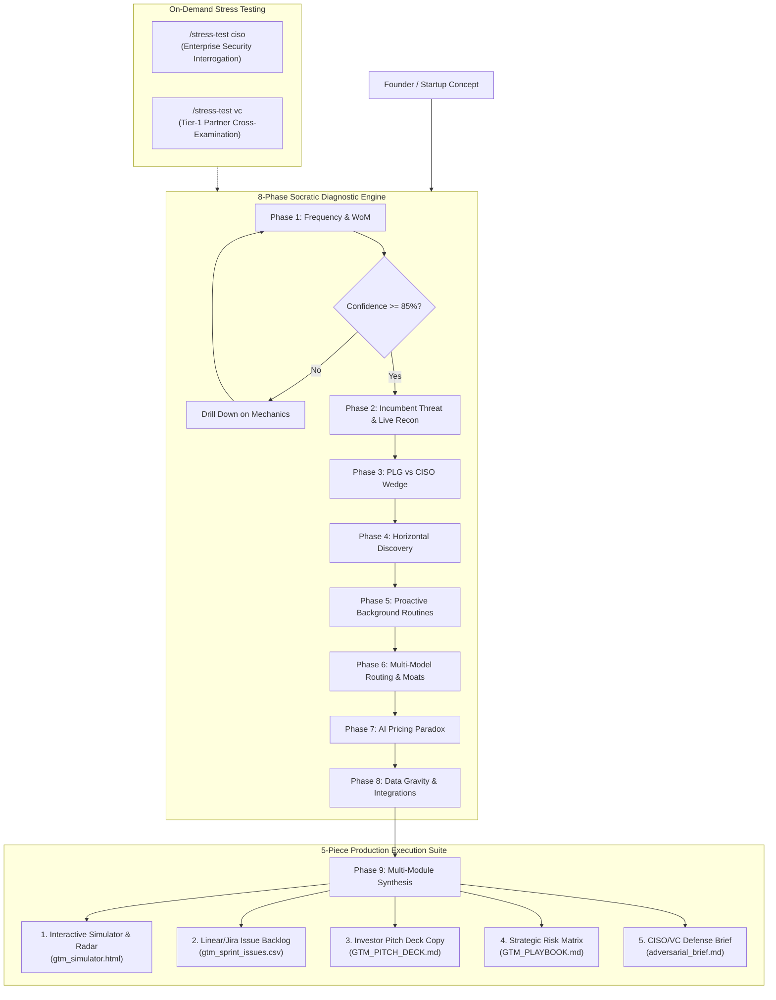

# Socratic GTM Strategist for AI Startups (v3.0)

[](https://github.com/zrk222/socratic-gtm-strategist/actions/workflows/ci.yml)
[](https://opensource.org/licenses/Apache-2.0)
[](https://modelcontextprotocol.io/)
[](https://python.org)
[](#-universal-platform-compatibility)

An elite AI Startup Strategy Partner, Socratic Advisor, and GTM Operating System designed to ruthlessly but constructively de-risk a founder's Go-To-Market (GTM) strategy before building unscalable or indefensible products.

Version 3.0 provides full **Universal Environment Compatibility** (Codex, Claude Code, Cursor, VS Code, OpenCode, and Antigravity) via both **CLI** and **Model Context Protocol (MCP)** stdio integration.

---

## 🏗️ System Architecture & Workflow



---

## 🎯 Strategic Overview

AI products face unique market dynamics that render traditional B2B SaaS playbooks obsolete:
- The death of per-seat SaaS pricing.
- The threat of foundational lab model improvements.
- The trap of low-frequency reactive text-boxes.
- Incumbent distribution advantages.

**Socratic GTM Strategist** conducts a structured, 8-phase Socratic dialogue with the founder, evaluates answers against strict red/green flags, verifies operational depth against an **85% confidence gate**, and synthesizes an entire execution toolkit.

---

## 🛠️ The 5 Operational Modules

| # | Module | What It Does | Tool / CLI Command |
| :---: | :--- | :--- | :--- |
| **1** | **Interactive GTM Radar & Margin Simulator** | Standalone dark-mode HTML dashboard featuring an **8-Vector Radar (Spider) Chart** and a **Live AI Unit Economics Calculator** with sliders for token costs, pricing, and tasks/day with dynamic margin health alerts. | `python cli.py simulate` |
| **2** | **Live Incumbent Reconnaissance** | Automated competitive intelligence query hook in Phase 2 (`"[Incumbent] AI agent announcements 2026"`). Extracts real product releases to challenge founder assumptions. | `python cli.py recon --incumbent <Name>` |
| **3** | **Adversarial Stress Test Modes** | On-demand subcommands: <br>• `/stress-test ciso` (Fortune 500 CISO interrogation on data egress, CMEK, SOC2)<br>• `/stress-test vc` (Tier-1 VC partner grilling on churn, margins, and lab commoditization). | `python cli.py stress-test --mode <ciso\|vc>` |
| **4** | **Executable Sprint Backlog Export** | Generates importable CSV and JSON backlogs for Linear, Jira, GitHub Issues, and Notion mapping Sprint 0 (Telemetry), Sprint 1 (Webhooks/Routines), and Sprint 2 (Metering/Moats). | `python cli.py export` |
| **5** | **Investor Pitch Deck Narrative Generator** | Transforms the strategic review into a 5-slide Seed/Series A narrative copy (The Wedge, The Agentic Shift, Incumbent Bypass, AI Economics, Data Gravity). | `python cli.py pitch-deck` |

---

## 💻 CLI Usage

### Interactive Terminal Walkthrough Mode
Launch an interactive Socratic audit session right inside your terminal:
```bash
python cli.py start
```

### Standalone CLI Subcommands
```bash
# 1. Generate the Interactive HTML Simulator & Risk Radar:
python cli.py simulate --project "MyAI" --scores "85,60,90,75,80,70,85,90" --output gtm_simulator.html

# 2. Run Live Competitor Recon:
python cli.py recon --incumbent "Salesforce" --domain "Customer Support AI"

# 3. Generate a CISO or VC Adversarial Defense Brief:
python cli.py stress-test --mode ciso --startup "MyAI"

# 4. Export Linear / Jira Sprint Backlog:
python cli.py export --csv sprint_issues.csv

# 5. Generate 5-Slide Pitch Deck Copy:
python cli.py pitch-deck --startup "MyAI"

# 6. Run the MCP Server over stdio:
python cli.py mcp
```

---

## 🌐 Universal Platform Compatibility

### 1. Claude Code & Claude Desktop (MCP & Instructions)
Claude Code automatically ingests [`CLAUDE.md`](./CLAUDE.md).

To connect as an **MCP Server** in Claude Desktop or Claude Code, add this to your `claude_desktop_config.json`:
```json
{
  "mcpServers": {
    "socratic-gtm": {
      "command": "python",
      "args": ["/path/to/socratic-gtm-strategist/cli.py", "mcp"]
    }
  }
}
```

### 2. Cursor (Rules & MCP)
* **Rules:** Automatically loaded via [`.cursorrules`](./.cursorrules).
* **MCP Integration:** Add to `.cursor/mcp.json` or your Cursor Settings:
```json
{
  "mcpServers": {
    "socratic-gtm": {
      "command": "python",
      "args": ["cli.py", "mcp"]
    }
  }
}
```

### 3. VS Code & GitHub Copilot
* **Copilot Instructions:** Built-in via [`.github/copilot-instructions.md`](./.github/copilot-instructions.md).
* **Tasks:** Run `Ctrl+Shift+P` -> `Tasks: Run Task` to trigger any GTM module directly via [`.vscode/tasks.json`](./.vscode/tasks.json).
* **Roo / Cline / MCP Extensions:** Point to `python cli.py mcp` in your extension's MCP configuration.

### 4. OpenCode
* Uses [`opencode.json`](./opencode.json) for automatic tool discovery, skill mounting, and MCP orchestration.

### 5. OpenAI Codex & Custom Agents
* Ingests [`CODEX.md`](./CODEX.md) or [`SKILL.md`](./SKILL.md) directly for automated agent guidelines and tool boundaries.

### 6. Antigravity & Gemini CLI
```bash
# Global skills installation:
git clone https://github.com/zrk222/socratic-gtm-strategist.git ~/.gemini/config/skills/socratic-gtm-strategist
```

---

## 🧭 The 8 Strategic Laws of AI GTM

1. **The Interaction Frequency Rule:** Low-frequency software (annual/seasonal) cannot sustain viral word-of-mouth.
2. **The Ticking Clock on Distribution:** Startups win on speed and UX; incumbents win on distribution. Network effects must be built before incumbents replicate core features.
3. **Bottom-Up User Delight vs. The CISO Trap:** Starting with IT/CISO compliance yields unloved software. Start with end-user delight (PLG), then layer enterprise controls.
4. **Proactive Routines vs. Text-Box Friction:** Value lies in proactive, background agentic routines, not chat-box friction.
5. **Horizontal Seeding to Organic Verticalization:** Discover high-ROI power-user workflows horizontally, then package vertical solutions from real pull.
6. **Model Neutrality & Context Ownership:** Avoid single-supplier derivative risk. Serve as a neutral router while the customer retains ownership of their context.
7. **The Pricing Paradox:** AI agents destroy seat-based pricing by replacing human labor. Value must be captured via outcomes, tasks, or consumption.
8. **Data Gravity & The Integration Moat:** Standalone tools fail. Bi-directional integrations establish the switching costs needed for durable moats.

---

## 📦 Repository Structure

```text
socratic-gtm-strategist/
├── cli.py                            # Unified CLI & MCP entrypoint (includes 'start' mode)
├── mcp_server.py                     # Standard JSON-RPC 2.0 MCP Server (stdio)
├── mcp.json                          # Standard MCP client configuration
├── CLAUDE.md                         # Claude Code CLI runtime instructions
├── CODEX.md                          # OpenAI Codex runtime instructions
├── .cursorrules                      # Cursor AI development rules
├── opencode.json                     # OpenCode plugin & skill manifest
├── .github/copilot-instructions.md   # GitHub Copilot / VS Code instructions
├── .vscode/tasks.json                # VS Code one-click execution tasks
├── .editorconfig                     # Consistent editor formatting rules
├── pyproject.toml                    # PEP 517/621 packaging metadata
├── SKILL.md                          # Full v3.0 Socratic System Skill
├── LICENSE                           # Apache License 2.0
├── README.md                         # Universal documentation
├── CONTRIBUTING.md                   # Community contribution guide
├── scripts/
│   ├── generate_dashboard.py         # Generates interactive HTML Radar & Margin Simulator
│   ├── incumbent_recon.py            # Automated competitor AI intelligence recon
│   ├── stress_test_simulator.py      # CISO & VC adversarial brief generator
│   ├── export_issues.py              # Exports Sprint 0-2 issues to Linear/Jira CSV & JSON
│   └── generate_pitch_deck.py        # Generates 5-slide venture pitch deck copy
├── templates/
│   ├── gtm_simulator.html            # Sample interactive simulator
│   ├── GTM_PLAYBOOK.md               # Sample strategic playbook
│   ├── GTM_PITCH_DECK.md             # Sample investor deck copy
│   └── gtm_sprint_issues.csv         # Sample Linear/Jira importable issues
└── tests/
    └── test_socratic_gtm.py          # Automated test suite (100% pass)
```

---

## 📄 License

Licensed under the Apache License, Version 2.0. See [LICENSE](./LICENSE) for details.
